<h1 data-importer="text" align="center">Welcome. Building secure, efficient, and scalable solutions.</h1>

## Toolbox

| Area | Tools |
| --- | --- |
| Frontend | JavaScript · TypeScript · React · Next.js · Tailwind CSS |
| Backend | Node.js · NestJS · PostgreSQL |
| Cloud & tools | AWS · Docker · Bash |

  
  

Discord: `george_dnf_dev`

  

## Recent activity

<!-- activity:start -->
_No recent public pushes, pull requests, or releases._
<!-- activity:end -->

## Contribution arcade

<picture data-importer="pacman">
  <source media="(prefers-color-scheme: dark)" srcset="https://raw.githubusercontent.com/GeorgeDeveloperJ/GeorgeDeveloperJ/pacman-output/pacman-contribution-graph-dark.svg?game=pacman">
  <source media="(prefers-color-scheme: light)" srcset="https://raw.githubusercontent.com/GeorgeDeveloperJ/GeorgeDeveloperJ/pacman-output/pacman-contribution-graph.svg?game=pacman">
  
</picture>
